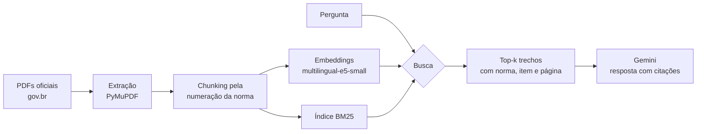

# Consulta às Normas Regulamentadoras com RAG

> **English summary:** Retrieval-Augmented Generation over Brazilian occupational safety regulations (NRs). Structure-aware chunking by regulation item, local multilingual embeddings, BM25 and hybrid (RRF) retrieval compared on a labeled question set, and answers from Google Gemini that cite the exact regulation item. Dense retrieval reached Recall@5 = 0.89 and MRR@10 = 0.72; the hybrid approach was measured and *did not* help on this data (see [Results](#resultados)).

Perguntas em linguagem do dia a dia ("a empresa pode cobrar pelo EPI?") respondidas a partir do texto oficial das NRs de segurança do trabalho, sempre com a norma e o item citados, para quem trabalha com QHSE conferir a fonte em segundos.

Normas no corpus: **NR-01** (gerenciamento de riscos), **NR-05** (CIPA), **NR-06** (EPI), **NR-11** (movimentação de materiais), **NR-17** (ergonomia), **NR-23** (incêndio) e **NR-35** (trabalho em altura).

## Como funciona



1. **Chunking pela estrutura da norma.** As NRs já são organizadas em itens numerados (`35.4.2.1`). Cada item vira um trecho, com suas alíneas; itens muito curtos são unidos ao seguinte da mesma seção, e itens longos são quebrados com sobreposição. O sumário e o histórico de portarias são descartados, anexos recebem rótulo próprio (`Anexo I 1.1`) e o glossário é separado por definição (`Glossário: Permissão de Trabalho - PT`). Resultado: 532 trechos, cada um citável.
2. **Busca.** Três modos: BM25 (palavras-chave, sem acento e sem stopwords), densa (embeddings `intfloat/multilingual-e5-small`, rodando localmente, com os prefixos `query:`/`passage:` que o E5 exige) e híbrida (Reciprocal Rank Fusion das duas).
3. **Geração.** Os trechos vão para o Gemini dentro de tags `<trecho norma=... item=... pagina=...>`. O prompt exige citar `[NR-xx, item y]` e dizer que não encontrou quando os trechos não respondem, em vez de completar com conhecimento próprio.

A busca e a avaliação rodam sem chave de API e sem custo. Só a resposta final usa o Gemini.

## Resultados

Avaliação com 28 perguntas escritas como um trabalhador perguntaria, cada uma rotulada com o item da norma que a responde ([`evaluation/questions.jsonl`](evaluation/questions.jsonl)). O script confere antes se todo item rotulado existe no índice.

| Busca | Recall@1 | Recall@3 | Recall@5 | Recall@10 | MRR@10 |
|---|---:|---:|---:|---:|---:|
| BM25 (palavras-chave) | 0.21 | 0.46 | 0.64 | 0.75 | 0.38 |
| **Densa (embeddings)** | **0.57** | **0.82** | **0.89** | **1.00** | **0.72** |
| Híbrida (RRF) | 0.43 | 0.71 | 0.86 | 0.93 | 0.59 |

Resultado por pergunta em [`evaluation/results.md`](evaluation/results.md).

**A busca híbrida não ajudou aqui.** A expectativa era que BM25 + embeddings superasse os dois, mas as perguntas usam vocabulário diferente do texto legal ("cobrar pelo EPI" contra "fornecer gratuitamente"; "cipeiro"; "empilhadeira" contra "equipamento de transporte motorizado"). O BM25 erra muito nesses casos, e o RRF dá peso igual às duas listas, então a lista fraca empurra para baixo o acerto da densa. Por isso a busca densa é o padrão. Não ajustei pesos olhando essas mesmas perguntas, porque isso seria otimizar para o próprio teste.

## Como rodar

Requer Python 3.12.

```bash
python -m venv .venv
.venv\Scripts\activate          # Linux/macOS: source .venv/bin/activate
pip install -r requirements.txt

python -m rag_nrs.download      # baixa os 7 PDFs oficiais (~3 MB)
python -m rag_nrs.index         # gera trechos e embeddings (baixa o modelo na 1ª vez, ~470 MB)
python -m evaluation.evaluate   # reproduz a tabela acima
pytest                          # testes de chunking, busca e montagem do prompt
```

Para gerar respostas, copie `.env.example` para `.env` e coloque uma chave gratuita do [Google AI Studio](https://aistudio.google.com/apikey):

```bash
python -m rag_nrs.cli "A empresa pode cobrar do funcionário pelo EPI?"
python -m rag_nrs.cli "Membro da CIPA pode ser demitido?" --no-llm   # só os trechos, sem chave
streamlit run app.py
```

## Estrutura

```
rag_nrs/
  sources.py      URLs oficiais das NRs
  download.py     baixa os PDFs
  chunking.py     divide o texto pela numeração dos itens
  ingest.py       extrai o texto e gera data/index/chunks.jsonl
  index.py        embeddings dos trechos
  retrieval.py    BM25, densa e híbrida (RRF)
  generate.py     prompt e chamada ao Gemini
  cli.py          linha de comando
app.py            interface em Streamlit, com link para o PDF oficial na página do trecho
evaluation/       perguntas rotuladas, métricas e resultados
tests/            pytest
```

## Limitações

- 28 perguntas é pouco para diferenças pequenas entre métodos; a diferença entre densa e BM25 é grande, mas entre densa e híbrida pode mudar com mais perguntas.
- As perguntas e os rótulos foram escritos pelo autor do projeto, que conhecia o corpus.
- A avaliação mede só a busca. A qualidade da resposta gerada (fidelidade às fontes, citações corretas) ainda não é medida automaticamente.
- Tabelas dos PDFs viram texto corrido na extração.
- Não é aconselhamento jurídico: o texto oficial publicado no DOU é o que vale.

## Próximos passos

- Reranking com um cross-encoder multilíngue sobre o top-20 da busca densa.
- Avaliar a resposta gerada: conferir se cada citação `[NR, item]` existe nos trechos enviados e se a afirmação está no trecho.
- Mais perguntas, escritas por outras pessoas da área de segurança do trabalho, separadas em conjunto de ajuste e de teste.

## Fontes

Textos das NRs publicados pelo Ministério do Trabalho e Emprego em [gov.br](https://www.gov.br/trabalho-e-emprego/pt-br/acesso-a-informacao/participacao-social/conselhos-e-orgaos-colegiados/comissao-tripartite-partitaria-permanente/normas-regulamentadora/normas-regulamentadoras-vigentes). Atos oficiais não são protegidos por direito autoral (Lei 9.610/98, art. 8º, IV).
